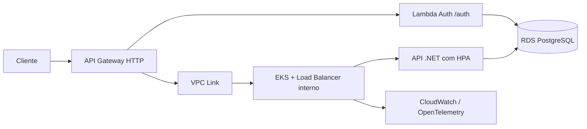

# Garage Management Infrastructure

Repositorio Terraform da plataforma AWS, EKS, Kubernetes e API Gateway do Garage Management.

## Repositorios da solucao

- [API principal e manifests Kubernetes](https://github.com/kmlyteixeira/garage-management-api-dotnet)
- [Lambda de autenticacao](https://github.com/kmlyteixeira/garage-management-lambda)
- [Infraestrutura EKS/API Gateway](https://github.com/kmlyteixeira/garage-management-infra)
- [Infraestrutura RDS PostgreSQL](https://github.com/kmlyteixeira/garage-management-database)

## Escopo

Este repositorio provisiona VPC, subnets publicas/privadas, NAT, security groups, IAM, EKS, node group, acesso ao cluster, VPC Link, API Gateway HTTP, throttling e integracoes com a Lambda de autenticacao e o Load Balancer interno da API. Os manifests da aplicacao, HPA, Job de migration e ConfigMaps permanecem na [API principal](https://github.com/kmlyteixeira/garage-management-api-dotnet/tree/main/k8s).

## Arquitetura



Rotas publicas: `POST /auth`, `GET /.well-known/jwks.json` e `GET /api/service-order/public-status`. As demais rotas passam pelo authorizer JWT configurado com issuer e audience.

## Ambientes e variaveis

Os ambientes aceitos sao `development`, `homologacao` e `producao`. O exemplo abaixo e seguro apenas para planejamento local:

```bash
terraform init
terraform plan -var='environment=homologacao' -var='region=us-east-1' -var='admin_principal_arn=arn:aws:iam::123456789012:role/garage-management-admin' -var='auth_lambda_function_arn=arn:aws:lambda:us-east-1:123456789012:function:garage-management-auth-homologacao' -var='jwt_issuer=https://auth.garage-management.example.com' -var='jwt_audience=garage-management-api'
```

Variaveis principais: `project_name`, `environment`, `region`, `availability_zones`, `eks_version`, `node_instance_type`, `node_min_size`, `node_desired_size`, `node_max_size`, `single_nat_gateway`, `admin_principal_arn`, `auth_lambda_function_arn`, `api_listener_arn`, `vpc_link_subnet_ids`, `vpc_link_security_group_ids`, `jwt_issuer` e `jwt_audience`. O ID AWS acima e ilustrativo e deve ser substituido.

## CI/CD

- `terraform.yml`: valida formatacao e configuracao Terraform em Pull Requests.
- `apply.yml`: executa plan/apply com aprovacao do Environment e credenciais OIDC/segredos do GitHub.
- Deploy da aplicacao e manifests ocorre no workflow da [API principal](https://github.com/kmlyteixeira/garage-management-api-dotnet/actions).
- `main`/`master` protegida, sem commits diretos; merge somente por Pull Request aprovado e checks verdes.
- `develop` e homologacao; `main` e producao. State remoto HCP Terraform deve ser separado por workspace/ambiente.

## Operacao

```bash
terraform fmt -check -recursive
terraform init
terraform validate
terraform plan -out=tfplan
terraform apply tfplan
aws eks update-kubeconfig --name <eks_cluster_name> --region us-east-1
kubectl get nodes
```

Antes do `apply` em producao, configure ao menos duas zonas, `single_nat_gateway=false`, `admin_principal_arn`, state remoto, IAM OIDC e secrets externos. Nunca versionar `.tfvars` com senha, tokens ou ARNs sensiveis.

## Observabilidade e seguranca

Use CloudWatch para logs, metricas e alarmes de API Gateway, Lambda e EKS; OpenTelemetry para traces e correlacao por `trace_id`/`request_id`; Metrics Server para CPU/memoria do HPA. Alertas obrigatorios: latencia, 5xx, Lambda errors/throttles, indisponibilidade do healthcheck, saturacao de CPU/memoria e falha do processamento de OS.

Security groups restringem o PostgreSQL ao security group da API. O API Gateway aplica throttling e JWT; IAM usa menor privilegio; secrets ficam em Secrets Manager/Parameter Store. Habilite CloudTrail, criptografia e retencao de logs conforme politica do ambiente.

## Outputs e entrega

Outputs usados pelos demais repositorios: nome do cluster EKS, endpoint/porta/nome do RDS quando exportados pelo workspace, IDs de VPC/subnets/security groups e URL do API Gateway. Registre os outputs sem expor credenciais.

- [Documentacao arquitetural](https://github.com/kmlyteixeira/garage-management-api-dotnet/tree/main/docs/architecture)
- [Swagger da API](https://github.com/kmlyteixeira/garage-management-api-dotnet#documentacao-da-api)
